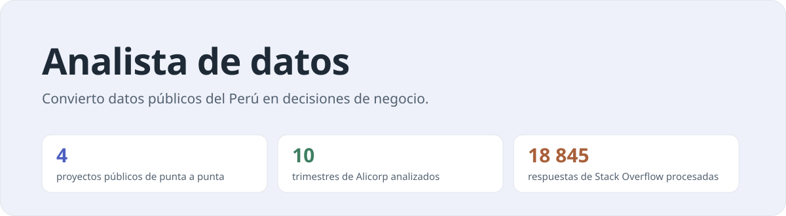
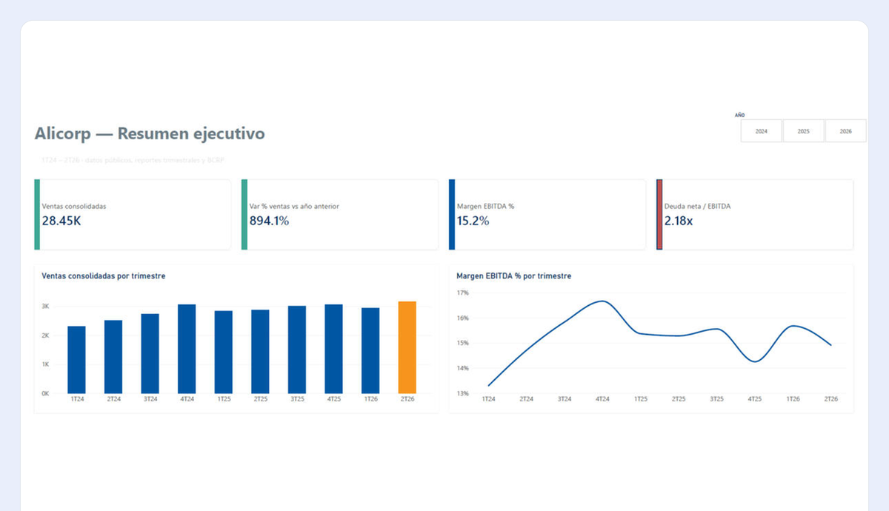
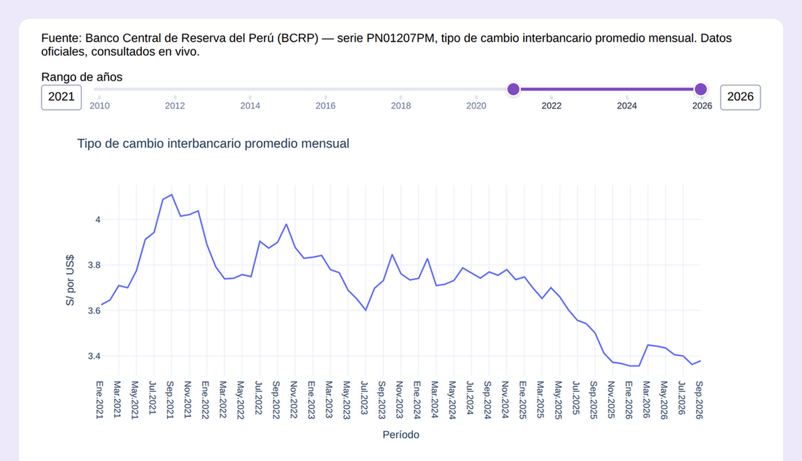
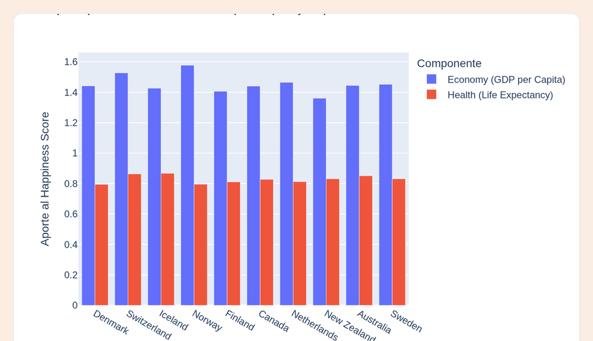
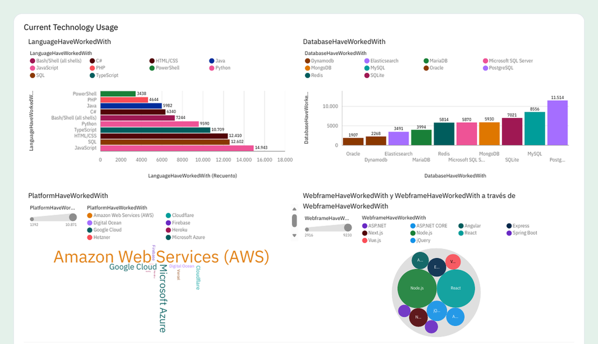

<picture>
  <source media="(prefers-color-scheme: dark)" srcset="assets/portada-dark.svg">
  
</picture>

### Sobre mí

Analizo datos públicos (BCRP, INEI, reportes de empresas) para responder preguntas de negocio concretas: qué está creciendo, por qué y qué conviene hacer. Trabajo de punta a punta, desde la extracción por API y la limpieza con pandas hasta el dashboard final en Power BI o Dash. Hoy exploro agentes de datos con LLMs.

### Proyectos de análisis

<table>
  <tr>
    <td width="50%" valign="top">
      <a href="https://github.com/asramirez-svg/alicorp-analisis-resultados">
        <picture>
          <source media="(prefers-color-scheme: dark)" srcset="assets/proyecto-alicorp-dark.png">
          
        </picture>
      </a>
      <h3><a href="https://github.com/asramirez-svg/alicorp-analisis-resultados">Alicorp: ¿qué impulsa sus resultados?</a></h3>
      
10 trimestres (1T24–2T26) y 4 unidades de negocio, con reportes públicos y la API del BCRP.

      
<code>→ Volumen +19 % vs. ventas +11 % en 2025</code>

      
Python · Power BI · DAX

    </td>
    <td width="50%" valign="top">
      <a href="https://github.com/asramirez-svg/dashboards-peru">
        <picture>
          <source media="(prefers-color-scheme: dark)" srcset="assets/proyecto-dashboards-peru-dark.png">
          
        </picture>
      </a>
      <h3><a href="https://github.com/asramirez-svg/dashboards-peru">Dashboards Perú</a></h3>
      
Tipo de cambio en vivo (API BCRP) y empleo por ciudad con microdatos INEI-EPEN.

      
<code>→ App en Dash con datos oficiales en vivo</code>

      
Python · Dash · Plotly

    </td>
  </tr>
  <tr>
    <td width="50%" valign="top">
      <a href="https://github.com/asramirez-svg/ia-generativa-world-happiness">
        <picture>
          <source media="(prefers-color-scheme: dark)" srcset="assets/proyecto-world-happiness-dark.png">
          
        </picture>
      </a>
      <h3><a href="https://github.com/asramirez-svg/ia-generativa-world-happiness">IA generativa · World Happiness</a></h3>
      
Dashboard Plotly y un agente que responde preguntas sobre los datos en lenguaje natural.

      
<code>→ LangChain + IBM watsonx (Llama)</code>

      
Python · LangChain · LLM

    </td>
    <td width="50%" valign="top">
      <a href="https://github.com/asramirez-svg/ibm-data-analyst-capstone">
        <picture>
          <source media="(prefers-color-scheme: dark)" srcset="assets/proyecto-ibm-capstone-dark.png">
          
        </picture>
      </a>
      <h3><a href="https://github.com/asramirez-svg/ibm-data-analyst-capstone">IBM Data Analyst Capstone</a></h3>
      
Tendencias tecnológicas con la encuesta de Stack Overflow: 18 845 respuestas.

      
<code>→ Dashboard en IBM Cognos</code>

      
Cognos · Excel · Power Query

    </td>
  </tr>
</table>

### Herramientas

- **Análisis:** Python · pandas · Excel / Power Query
- **Visualización:** Power BI (DAX) · Dash · Plotly · matplotlib · IBM Cognos
- **IA:** LangChain · IBM watsonx · LLMs
- **Datos:** APIs REST (BCRP) · microdatos INEI
